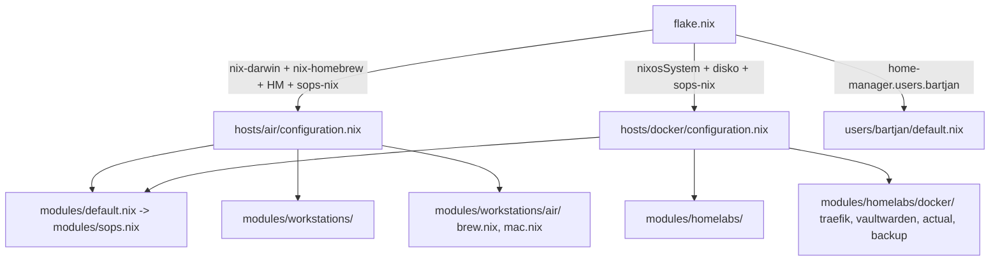

# Repository Guidelines

## Project Overview

Personal Nix flake for Bartjan's machines:

- `air`: an aarch64-darwin Mac managed by nix-darwin, nix-homebrew, and home-manager (as a darwin module).
- `docker`: an x86_64-linux NixOS homelab VM running Traefik, Vaultwarden, and Actual in Podman containers. Disks are managed by disko.

Secrets are stored in the private, non-flake input `sops-repo` (`BHenkemans/nix-secrets`). No secret files are kept in this repo.

`CLAUDE.md` is stale. It lists a nonexistent `nixrdp` host, alacritty, the wrong brew lists, a root `assets/` directory, and commands such as `nix typeCheck` and `home-manager switch`. Trust the files and this document over it.

## Architecture & Data Flow



- `specialArgs = { inherit self inputs; }` is passed to every host. Home-manager receives `extraSpecialArgs = { inherit inputs; }`. Modules reach other flakes through `inputs.*`, for example `inputs.sops-repo + "/secrets.yaml"`. Hosts use `self` for `system.configurationRevision`.
- `flake.nix` also declares `nixosConfigurations.nixrdp`, but `hosts/nixrdp/` and `users/bartjan/linux.nix` do not exist. That output fails to evaluate, and so does `nix flake check`. Do not try to fix it unless asked.
- The home-manager config is only wired into `air`. Its files hard-code macOS paths (`/Users/bartjan`, `/Applications/OmniWM.app`, launchd agents) and have no platform guards.

### SOPS layers

| Layer | File | `defaultSopsFile` | Key source |
|---|---|---|---|
| System base (both hosts) | `modules/sops.nix` | – | `/etc/ssh/ssh_host_ed25519_key`; keyFile `/var/lib/sops-nix/key.txt` (darwin) or `/etc/sops/key` (linux) |
| Workstation system | `modules/workstations/sops.nix` | `inputs.sops-repo + "/secrets.yaml"` | ↑ |
| Homelab system | `modules/homelabs/sops.nix` | `inputs.sops-repo + "/homelab.yaml"` | ↑ |
| Home-manager | `users/bartjan/sops.nix` | `inputs.sops-repo + "/secrets.yaml"` | `~/Library/Application Support/sops/age/keys.txt` |

- Secret names are slash-namespaced: `traefik/cf`, `vaultwarden/admin_token`, `actual/openid_client_id`, `borg/<name>`, `private_keys/bartjan`.
- Consume secrets through `config.sops.secrets."<name>".path`. Containers that need env files use `sops.templates."<x>.env"` with `config.sops.placeholder."<name>"`.
- One override exists: `modules/homelabs/users.nix` reads the user password from `secrets.yaml` through an explicit `sopsFile`.
- `.sops.yaml` holds only creation rules and public age recipients (`bartjan`, `air`). The docker host key is not listed there.

### Homelab containers (`modules/homelabs/docker/`)

- The runtime is Podman with `dockerCompat` and `dockerSocket` (`docker.nix`). The `oci-containers` backend is set to `"podman"` in `traefik/default.nix`.
- `docker.nix` adds `restartTriggers = [ config.system.configurationRevision ]` to every `podman-*` unit, so each rebuild restarts and re-pulls the containers.
- Networks are created by oneshot units, `podman-<x>-network`. Traefik and Actual use `proxy`; Vaultwarden uses its own `vaultwarden` network.
- Containers are exposed to Traefik through labels (`exposedByDefault: false`) and get certificates through the Cloudflare DNS-01 resolver `cloudflare`.
  - Static config: `traefik/assets/traefik.yml`.
  - Dynamic LAN routes and the `secured` middleware: `traefik/assets/traefik-config.yml`.
  - Both files are installed through `environment.etc`.
- Only Vaultwarden has a Cloudflare tunnel, via the `vaultwarden-tunnel` container. Actual and Traefik are LAN-only behind Traefik.
- `backup.nix` defines the custom option `homelab.backups.<name>` with `repo`, `paths`, `exclude`, `preHook`, and a read-only `stagingDir`.
  - Each entry generates `services.borgbackup.jobs.<name>` and `sops.secrets."borg/<name>"`.
  - No backups are enabled right now. The Vaultwarden example is commented out.
- `github-runner` is commented out in `modules/homelabs/docker/default.nix`, and its directory does not exist.
- Firewall: `modules/homelabs/firewall.nix` uses nftables with `rulesetFile = ./assets/nftables.conf`, and `networking.firewall` is disabled. Edit the `.conf` file, not NixOS firewall options.

## Key Directories

| Path | Purpose |
|---|---|
| `hosts/<host>/` | Per-host entry points: `configuration.nix`, plus `disko.nix` for docker. State versions live here (air: `6`, docker: `"26.05"`). |
| `modules/` | `default.nix` is shared by both hosts: flakes features plus `sops.nix`. |
| `modules/workstations/` | Darwin system config: nix settings and caches, `allowUnfree`, users, ssh, `unconfigured_packages.nix`. |
| `modules/workstations/air/` | `brew.nix` (Homebrew brews and casks) and `mac.nix` (`system.defaults`). |
| `modules/homelabs/` | Base NixOS homelab modules: firewall, gc, qemu guest, ssh hardening, user `abartjan`. |
| `modules/homelabs/docker/` | The container stack and the borg backup option. |
| `users/bartjan/` | Home-manager modules. `default.nix` imports borg, firefox, git, nvim, omniwm, sops, terminal, vscode. |
| `tmp/` | Gitignored. Holds local age keys (`tmp/etc/sops/key`, `tmp/var/lib/sops-nix/key.txt`). Never read, print, or commit them. |

## Development Commands

```bash
nix fmt                                   # nixfmt (formatter output: aarch64-darwin, x86_64-linux)
nix fmt -- --check .                      # report unformatted files

# Evaluation checks (verified working; nixrdp fails by design)
nix eval .#darwinConfigurations.air.config.system.build.toplevel.drvPath
nix eval .#nixosConfigurations.docker.config.system.build.toplevel.drvPath
nix build .#darwinConfigurations.air.system --dry-run

# Apply (local only; never apply on a remote host without explicit permission)
sudo darwin-rebuild switch --flake .#air
nixos-rebuild switch --flake .#docker --target-host <host>   # remote: needs write permission

nix flake update                          # or: nix flake update <input>
```

- There is no `devShells`, `checks`, `packages`, or `homeConfigurations` output. `home-manager switch` and `nix build` without an attribute both fail.
- The formatter is `nixfmt-rfc-style`, which warns that it is deprecated in favour of `pkgs.nixfmt`. Some files are currently unformatted (`hosts/air/configuration.nix`, `modules/default.nix`, `modules/homelabs/docker/backup.nix`). Do not reformat unrelated files in a focused change.
- Evaluation fetches the private inputs `sops-repo` and `nvchad-starter`. They must be reachable, either from the local store or with GitHub access.

## Code Conventions & Common Patterns

- **Layout:** every directory has a `default.nix` containing only `imports = [ ... ]`. Keep each import list alphabetical. A new concern gets its own file or directory and is added to the parent's `imports`.
- **Module arguments:**
  - Use `_:` when the module needs nothing.
  - Otherwise use a minimal `{ pkgs, lib, config, ... }:`.
  - Use `{ inputs, ... }:` for flake inputs and `{ self, ... }:` for the revision.
- **Platform guards:** use `lib.optionalAttrs pkgs.stdenv.isLinux { ... }` or `lib.optionals pkgs.stdenv.isLinux [ ... ]`, as in `modules/workstations/users.nix`. `modules/sops.nix` branches with `if pkgs.stdenv.isDarwin`.
- **Packages:** system packages live in `*/unconfigured_packages.nix`. Workstations use `with pkgs; [ ... ]`; homelabs use `pkgs.x`. Prefer `programs.<x>` (home-manager or nix-darwin) over raw packages. GUI apps that need stable `/Applications` paths or TCC grants go in `brew.nix` casks.
- **Homebrew:** `onActivation.cleanup = "zap"` uninstalls every brew or cask not declared in `brew.nix`. Never remove an entry casually.
- **Python:** there is no global Python. Python lives in per-project direnv shells (`programs.direnv` with nix-direnv).
- **Generated units:** use `lib.mapAttrs'` with `lib.nameValuePair` (see `docker.nix` and `backup.nix`). The only custom options use `lib.mkOption` with `types.submodule`, in `backup.nix`.
- **Home-manager patterns:**
  - Wrap scripts with `pkgs.writeShellApplication` and pass dependencies in `runtimeInputs` (`users/bartjan/borg.nix`).
  - Launchd services go in `launchd.agents.<name>.config` (`borg.nix`, `omniwm.nix`).
  - Activation hooks use `config.lib.dag.entryAfter [ "setupSops" ]` and `$DRY_RUN_CMD`.
- **Container pattern:** declare the image (`:latest`) in `virtualisation.oci-containers.containers.<name>`. Add `--network=proxy` plus Traefik labels for LAN exposure. Mount secrets from `config.sops.secrets.*.path` or use `environmentFiles` from `sops.templates`.
- **Comments:** avoid comments. Code should be self-explanatory (user rule).
- **Commits:**
  - Write short imperative subjects, for example `Migrate to ghostty` or `Drop brew python@3.12 and uv; Python lives in direnv shells`.
  - Use `chore: flake update` for lock bumps.
  - Commits are SSH-signed (`users/bartjan/git.nix`).

## Important Files

- `flake.nix`: inputs (all pinned to 26.05 branches; most follow `nixpkgs`), the three host outputs, and `formatter`.
- `hosts/air/configuration.nix`: platform, timezone, `nix.gc`, revision, state version.
- `hosts/docker/configuration.nix` and `hosts/docker/disko.nix`: boot, hostname, and the single-disk layout on `/dev/sda`.
- `modules/workstations/nix.nix`: `allowUnfree`, `trusted-users`, substituters (nix-community, cache.nixos.org, luukblankenstijn cachix).
- `modules/workstations/air/brew.nix` and `mac.nix`: Homebrew and macOS defaults. `spaces.spans-displays = false` is required by OmniWM.
- `users/bartjan/omniwm.nix`: launchd agent for the OmniWM cask. `~/.config/omniwm/settings.toml` is unmanaged and has a strict schema.
- `users/bartjan/borg.nix`: Mac backup script and launchd schedule (09:00, 15:00, 21:00). Writes to a Hetzner StorageBox and an rclone crypt mount.
- `modules/homelabs/assets/nftables.conf` and `modules/homelabs/docker/traefik/assets/*.yml`: raw config files.

## Runtime/Tooling Preferences

- Nix with flakes. Missing tools come from `nix shell nixpkgs#<pkg>`; do not install them globally.
- The target platforms are fixed: `aarch64-darwin` (air) and `x86_64-linux` (docker). Linux outputs cannot be built locally on the Mac. Use `nix eval` to check them.
- Remote hosts (docker, the StorageBox) need explicit user permission: read access for any remote read, write access for any deploy.

## Testing & QA

- There are no tests, no CI, and no `checks` output. QA consists of:
  1. `nix fmt` on the files you touched.
  2. The `nix eval ...toplevel.drvPath` command for every host affected by the change.
  3. For darwin, optionally `nix build .#darwinConfigurations.air.system --dry-run`.
- A shared module such as `modules/default.nix` or `modules/sops.nix` affects both hosts, so evaluate both.
- Do not rely on `nix flake check`. It fails on the broken `nixrdp` output.
